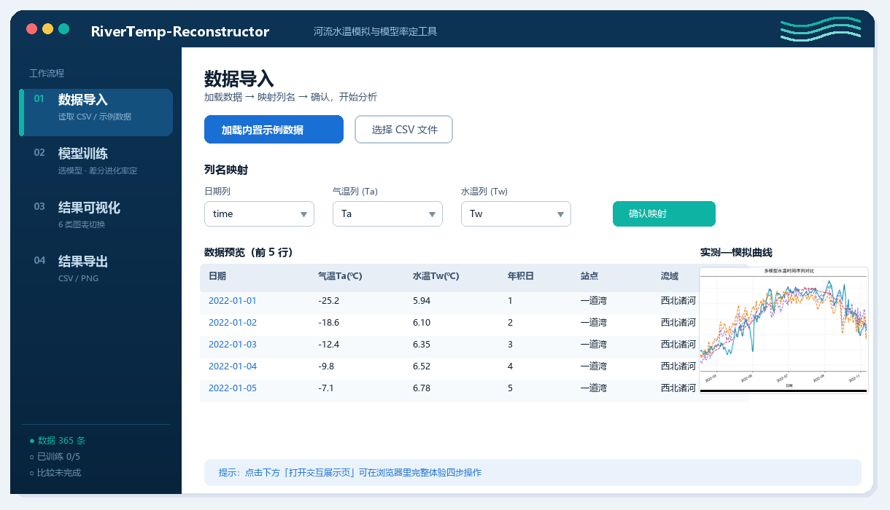

<div align="center">

# 河流水温模拟软件

**数据导入 · 模型训练 · 结果可视化 · 结果导出**

[](https://liu13754606161-netizen.github.io/WaterTemp_App/)

[]()
[]()
[]()

</div>

---

## 软件界面

[](https://liu13754606161-netizen.github.io/WaterTemp_App/)

上面的展示页完整复刻了软件主窗口，可以直接点击操作：加载示例数据、确认列名映射、切换模型训练、比较模型、查看图表、导出结果。

[点击打开交互展示页 →](https://liu13754606161-netizen.github.io/WaterTemp_App/)

### 01 数据导入


支持读取本地 CSV 或加载内置示例数据，列名下拉映射时间、气温、水温三列，下方表格实时预览，右下角确认映射后进入训练流程。

### 02 模型训练


五种模型可切换，公式面板与参数说明随模型联动；差分进化算法率定参数，训练完成后显示 RMSE、MAE、R²、NSE 四项指标及拟合参数表，并可勾选多个已训练模型进行比较。

### 03 结果可视化


六个图表标签：实测模拟时间序列、散点拟合、当前模型时间序列、多模型对比、RMSE 柱状图、NSE 柱状图。

### 04 结果导出


预览逐日模拟结果，一键导出带 BOM 的 CSV（Excel 打开不乱码）或导出图表 PNG。

---

## 内置模型与实测表现

示例数据集（365 条日尺度记录）上的 RMSE，单位 ℃：

| 模型 | 类型 | RMSE |
|---|---|---:|
| Random Forest | 数据驱动 | 0.1721 |
| Air2Stream | 机制模型 | 0.8219 |
| Seasonal Linear | 机制模型 | 1.2685 |
| Linear Regression | 统计模型 | 1.6030 |
| Equilibrium Temperature | 统计模型 | 1.6030 |

---

## 文件结构

```
WaterTemp_App/
├── index.html                  交互展示页（GitHub Pages 入口）
├── app.py                      主窗口与四个功能页
├── core.py                     数据读取、序列构建、模型调用
├── metrics.py                  RMSE / MAE / R² / NSE
├── model_training.py           训练流程
├── model_comparison.py         多模型比较与结果导出
├── models/                     五个模型实现与工厂
├── ui/                         公式面板
├── 示例数据.csv                 内置示例数据
├── model_comparison.csv        实测指标
├── comparison_*.png            实测对比图
├── start_desktop.bat           Windows 启动脚本
└── requirements.txt            依赖清单
```

---

[在线交互展示](https://liu13754606161-netizen.github.io/WaterTemp_App/) · [仓库地址](https://github.com/liu13754606161-netizen/WaterTemp_App)
