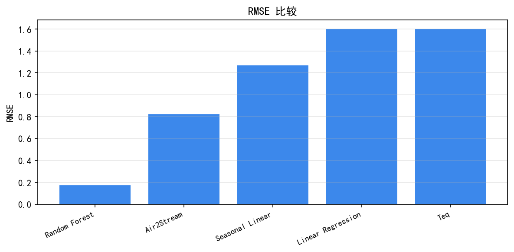
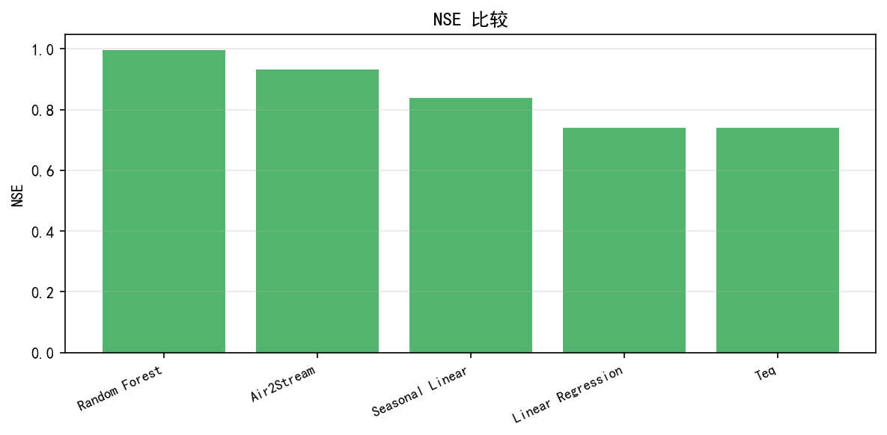

<div align="center">

# RiverTemp-Reconstructor

**基于气温的河流水温模拟与模型率定工具**

[]()
[]()
[]()
[]()

</div>

---

## 这个软件是做什么的

RiverTemp-Reconstructor 是一个 Windows 桌面软件。给它一份包含**日期、逐日气温（Ta）、实测水温（Tw）**的 CSV，它就能：

- 用内置的 5 种模型，从气温推算出对应日期的水温；
- 用差分进化算法自动率定机制模型的参数；
- 计算 RMSE / MAE / R² / NSE 四项精度指标，把多个模型排在一起比较；
- 一键导出逐日模拟结果和对比图。

全程图形界面操作，从数据导入到结果导出不需要写代码。

**适用场景**：水温—气温关系研究、机制模型参数率定、多模型精度对比、教学演示。

> 说明：本软件在有实测水温的日期上做**拟合与精度评价**。它不会凭空填补缺测日的水温——缺失的记录会被过滤掉（这是当前版本的边界，不是 bug）。

## 功能一览

| 模块 | 能做什么 |
|---|---|
| 数据导入 | 读本地 CSV 或加载内置示例；下拉映射日期/气温/水温三列；表格实时预览 |
| 模型训练 | 5 种模型切换；公式面板随模型联动；差分进化自动率定；训练完成填充四项指标 |
| 模型比较 | 勾选多个已训练模型，按 RMSE 排序，生成对比表并自动导出 4 张图 |
| 结果可视化 | 时间序列、散点拟合、多模型对比、RMSE / NSE 柱状图 |
| 结果导出 | 逐日模拟结果 CSV（UTF-8 BOM，Excel 打开不乱码）与图表 PNG |

## 内置模型

| 模型 | 类型 | 说明 |
|---|---|---|
| Air2Stream | 机制模型 | 气温—水温能量平衡微分方程，5 参数，差分进化率定 |
| Linear Regression | 统计模型 | 气温与水温的线性回归 |
| Seasonal Linear | 统计模型 | 在线性回归上叠加季节周期项 |
| Teq | 统计模型 | 平衡温度模型，按年积日计算平衡水温 |
| Random Forest | 数据驱动 | 随机森林回归，输入气温与年积日 |

## 实测效果

内置示例数据（365 天，站点：一道湾）上的拟合结果：

| 模型 | RMSE | NSE |
|---|---:|---:|
| Random Forest | 0.1721 | 0.9970 |
| Air2Stream | 0.8219 | 0.9319 |
| Seasonal Linear | 1.2685 | — |
| Linear / Teq | 1.6030 | 0.7405 |






> 这些指标是**样本内拟合优度**，不是独立测试集上的泛化能力。用于对比模型在已知数据上的拟合表现，不代表对未知年份的外推精度。

---

## 下载与运行

### 1. 下载

仓库页面点绿色 **Code** → **Download ZIP**，解压；或命令行克隆：

```bash
git clone https://github.com/liu13754606161-netizen/WaterTemp_App.git
```

### 2. 准备环境

安装 **Python 3.11**（安装时勾选 "Add Python to PATH"）：https://www.python.org/downloads/

然后装依赖：

```bash
cd WaterTemp_App/software
pip install -r requirements.txt
```

### 3. 启动

**Windows**：进入 `software` 文件夹，双击 `start_desktop.bat`。脚本会检查 Python 3.11 与依赖，缺什么装什么，然后启动程序。

或命令行：

```bash
cd WaterTemp_App/software
python app.py
```

### 4. 第一次使用

1. 「数据导入」页点 **加载内置示例数据**（365 条日尺度记录）
2. 确认时间列 `time`、气温列 `Ta`、水温列 `Tw` 的映射，点 **确认列名映射**
3. 「模型训练」页选模型，点 **开始训练**，完成后显示四项指标与拟合参数
4. 勾选多个模型点 **模型比较**，结果按 RMSE 排序
5. 「结果可视化」页看图，「结果导出」页导出 CSV 和 PNG

自己的数据按示例格式准备：至少包含日期、气温、水温三列，编码支持 UTF-8 与 GBK。

---

## 项目结构

```
WaterTemp_App/
├── README.md                    本说明
├── software/                    ★ 软件本体（下载后运行这个）
│   ├── app.py                   主窗口、四个功能页、交互逻辑
│   ├── core.py                  数据清洗、序列构建、Air2Stream 模拟、率定
│   ├── metrics.py               RMSE / MAE / R² / NSE
│   ├── model_training.py        训练流程封装
│   ├── model_comparison.py      多模型比较、图表绘制、结果导出
│   ├── models/                  5 种模型的公式、参数与工厂
│   ├── ui/formula_panel.py      公式面板
│   ├── 示例数据.csv              内置示例（365 天）
│   ├── model_comparison.csv     示例集实测指标
│   ├── comparison_*.png         实测对比图
│   ├── requirements.txt         依赖清单
│   ├── start_desktop.bat        Windows 一键启动
│   └── clean_cache.bat          缓存清理
└── showcase/                    交互式展示页（次要，浏览器直接打开）
    ├── index.html               模拟软件操作的网页
    └── assets/                  网页所用图片
```

## 技术栈

Python 3.11 · PyQt5 · NumPy · Pandas · SciPy · scikit-learn · Matplotlib

## 许可

仅供学习与研究使用。
