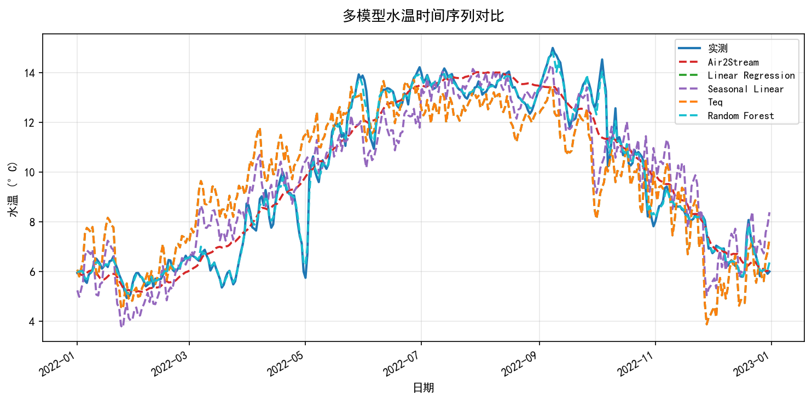
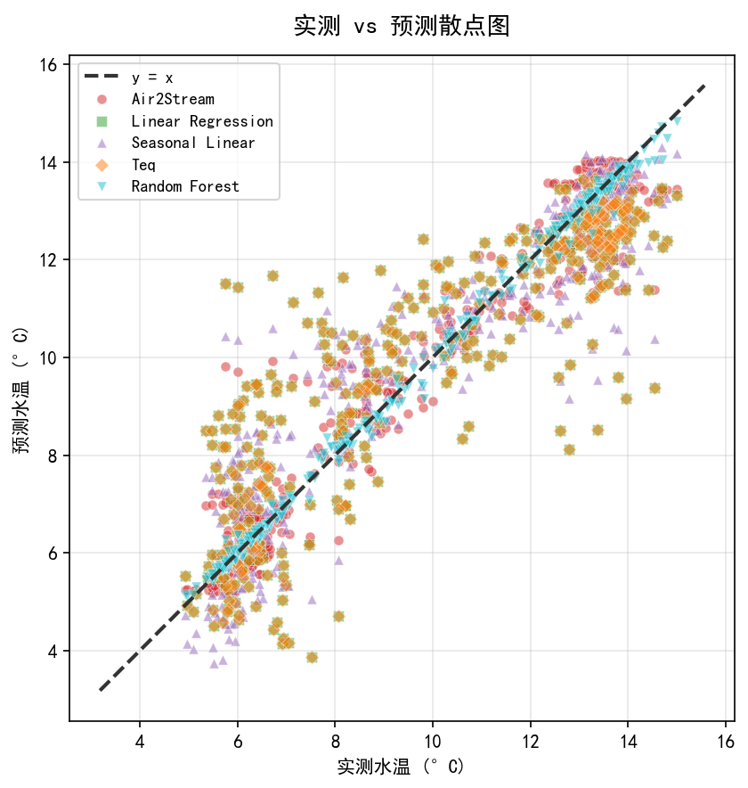

<div align="center">

# 河流水温模拟软件

**数据导入 · 模型训练 · 结果可视化 · 结果导出**

[]()
[]()
[]()

</div>

---

## 软件界面

### 01 数据导入

- 选择本地 CSV 或加载内置示例数据（365 条日尺度记录）
- 下拉映射时间列 `time`、气温列 `Ta`、水温列 `Tw`
- 七列数据实时预览，确认映射后进入训练

### 02 模型训练

- 五种模型切换：Air2Stream、Linear、Seasonal Linear、Equilibrium Temperature、Random Forest
- 公式面板与参数说明随模型联动
- 差分进化算法率定参数，进度条实时更新
- 训练完成显示 RMSE、MAE、R²、NSE 四项指标与拟合参数表
- 勾选多个已训练模型即可比较，结果按 RMSE 排序

### 03 结果可视化

六个图表标签：实测—模拟时间序列、散点拟合、当前模型时间序列、多模型对比、RMSE 柱状图、NSE 柱状图。

实测—模拟时间序列：



散点拟合：



模型 RMSE 对比：


模型 NSE 对比：


### 04 结果导出

- 预览逐日模拟结果表
- 导出带 BOM 的 CSV（Excel 打开不乱码）
- 导出图表 PNG

---

## 内置模型与实测表现

示例数据集上的 RMSE，单位 ℃：

| 模型 | 类型 | RMSE |
|---|---|---:|
| Random Forest | 数据驱动 | 0.1721 |
| Air2Stream | 机制模型 | 0.8219 |
| Seasonal Linear | 机制模型 | 1.2685 |
| Linear Regression | 统计模型 | 1.6030 |
| Equilibrium Temperature | 统计模型 | 1.6030 |

---

## 文件结构

```
WaterTemp_App/
├── app.py                      主窗口与四个功能页
├── core.py                     数据读取、序列构建、模型调用
├── metrics.py                  RMSE / MAE / R² / NSE
├── model_training.py           训练流程
├── model_comparison.py         多模型比较与结果导出
├── models/                     五个模型实现与工厂
├── ui/                         公式面板
├── 示例数据.csv                 内置示例数据
├── model_comparison.csv        实测指标
├── comparison_*.png            实测对比图
├── start_desktop.bat           Windows 启动脚本
└── requirements.txt            依赖清单
```

---

[仓库地址](https://github.com/liu13754606161-netizen/WaterTemp_App)
